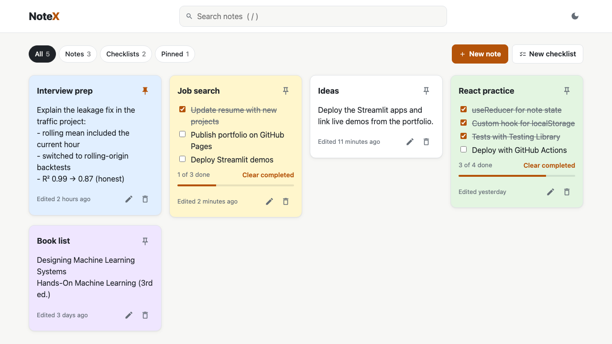
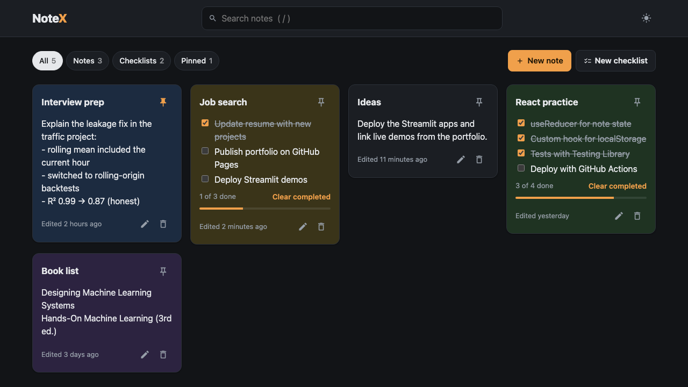

# NoteX

A notes and checklist app built with React. Notes are saved in the browser, so there's no account or backend.

**Live demo:** https://sudhanshu-pandey-18.github.io/notex/



## Features

- Plain notes and checklists in one place. Checklists show progress ("3 of 4 done") and can clear completed items
- Edit, delete with undo, pin, and colour-code notes
- Search across titles, text and checklist items, plus filters for notes, checklists and pinned
- Light and dark theme (follows the system until you pick one)
- Keyboard shortcuts: `/` to search, `Enter` for the next checklist item, `Ctrl/Cmd + Enter` to save, `Esc` to close
- Works on phones and is usable with a keyboard or screen reader



## How it's built

- React 19 and Vite
- Note state lives in a `useReducer`. All the logic (create, update, delete, restore, search, sort) is plain functions in `src/lib/notes.js`, which keeps it easy to test
- A small `useNotes` hook loads and saves notes to `localStorage`
- Tests with Vitest and React Testing Library cover the note logic and the main user flows
- GitHub Actions runs lint and tests on every push and deploys the build to GitHub Pages

```
src/
  App.jsx               layout, filters, editor and undo state
  components/           Header, FilterBar, NoteCard, NoteEditor, UndoToast
  hooks/                useNotes, useLocalStorage
  lib/notes.js          note logic (reducer, search, sorting)
  lib/notes.test.js     unit tests
  App.test.jsx          UI tests
```

## Running locally

```bash
npm install
npm run dev      # http://localhost:5173
npm test         # run the tests
npm run build    # production build in dist/
```

## Background

This started as two small exercises from a web development course: a React notes app and a plain JavaScript to-do list. I rebuilt them as one app, fixed a bug where deleting a note removed every note with the same title, and added editing, search, checklists, undo, tests and deployment.
